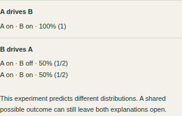
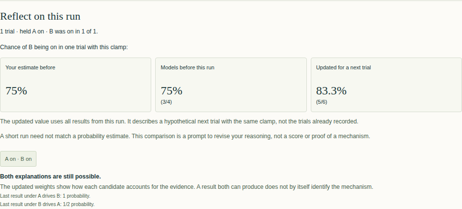
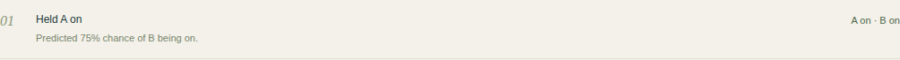

# Your first EQUIVIA investigation

Watching two lamps move together leaves a question: does A drive B, or does B drive A? Try one intervention, update your prediction, and save the evidence so you can return to it.

## Open the example

Launch EQUIVIA using the instructions in the private [Linux release](https://github.com/Jacob-Met/equivia/releases/tag/v0.1.0-linux.3) or [macOS release](https://github.com/Jacob-Met/equivia/releases/tag/v0.1.0-macos.3). The laboratory works without optional model guidance; this walkthrough used none.

Download [the starting notebook](first-investigation/starting-notebook.json), then open it using EQUIVIA's notebook control. This example uses **seed 2** to reproduce the path shown below. Follow the same steps in order; other seeds or additional trials can produce different outcomes.

## Watch, then change one thing

Record **one additional set of passive observations**. Both explanations remain at 50% conditional weight. The observed lamps agree under either candidate, so more watching cannot distinguish this pair.

Choose **A** as the lamp to hold, choose **on**, and open the prediction comparison.

Holding A on makes the candidates predict different distributions. If A drives B, B must be on. If B drives A, B keeps following its own random input, with a one-half chance of being on.

With equal weight on the candidates, the combined forecast is **3/4, or 75%**—halfway between certainty and a one-half chance. Enter **75** as your prediction, then run **one trial**.

## Update confidence without claiming proof

In this recorded example, B is on. Both candidates can produce that outcome, but it is twice as likely if A drives B. The conditional weights become **2/3 for A driving B** and **1/3 for B driving A**.

For a new trial with the same clamp, the forecast becomes **5/6**, approximately **83.3%**. Two-thirds of the weight supports a mechanism that always turns B on; the other third supports a mechanism that turns B on half the time: **2/3 + 1/6 = 5/6**.

The updated forecast describes a hypothetical next trial. It does not change your original prediction, and this shared result does not prove which mechanism is hidden. Both explanations remain possible within these declared worlds.

If a different run produces B off, follow the application's evidence instead: that result is impossible under the candidate in which A drives B.

## Save and reopen your investigation

Write what you think the result supports—for example, “B being on favors A driving B, but the reverse mechanism remains possible.” Save your notebook file.

Start a new investigation, then open the file you just saved. Your journal entry, prediction, explanation, conditional weights and **five remaining trials** return. Reopening checks the recorded results against executable replay; reloading the page also retained this investigation in the verified walkthrough.

The notebook keeps the worlds, ordered evidence, predictions and replay state needed to continue. The immediate **Reflect on this run** panel closes when you reopen; review the journal and restored investigation state instead.

---

Verified 29 October 2026 using seed 2 and source `ebe07b6d76dbb992a34d3dac644bf53cd4e6072f`. Screenshots show the running packaged application. This is one reproducible walkthrough, not a guarantee of the same result for other investigations.
